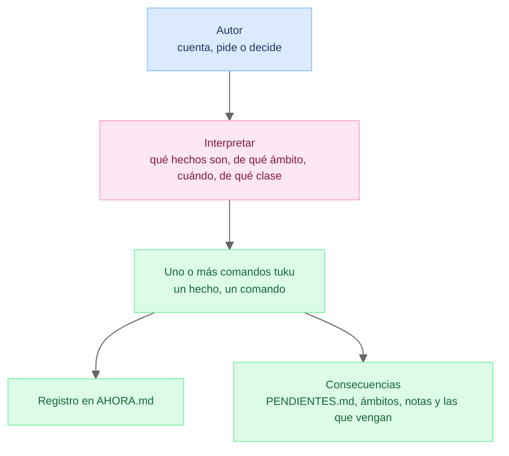
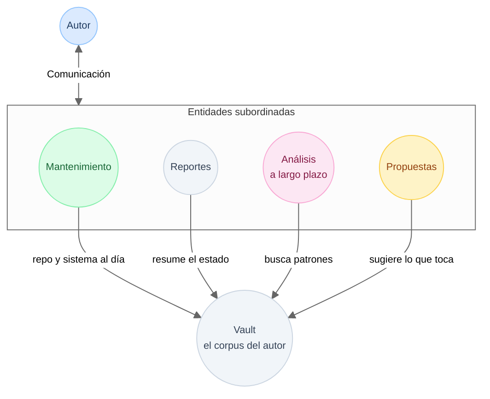

# spec · flujo de la información

> El marco al que sirven las demás specs. Se justifica por los principios 1, 3, 4, 8 y 9 de [`../docs/principios.md`](../docs/principios.md).

Lo que el autor dice llega al vault como uno o más comandos `tuku`, y cada comando escribe el registro y actualiza todo lo que depende de él. El flujo no depende de quién interprete lo dicho: una persona contratada para llevar la bitácora lo sigue igual que un agente. Lo que cambia con un agente de IA está en [agente.md](agente.md).

## Capturar la intención del autor

El autor dice «quedamos así: el viernes hablo con la Carla por las presentaciones resumen». Quien interpreta lo reconoce como un pendiente con vencimiento, elige el ámbito `tesis-javier-castro` y ejecuta:

```bash
tuku todo open --scope tesis-javier-castro --body "hablar con Carla Fuentes por las presentaciones resumen" --due "2026-08-14"
```

El comando escribe la línea en el día de `AHORA.md`, agrega la fila en `PENDIENTES.md` y actualiza las vistas que se derivan de ella. El autor no abrió ninguno de los tres archivos. Para eso existen los comandos: para que no gaste tiempo propagando un cambio de un archivo a otro.



El juicio está solo en la caja rosada (principio 4). Interpretar termina cuando cada hecho tiene ámbito, hora y clase, y desde ahí todo es determinista: construir la línea, ponerla en su día y actualizar lo que depende de ella.

## Puntos de entrada

Las entradas se clasifican por lo que producen y no por cómo llegan. Hay seis familias, y una entrada nueva se ubica primero en una de ellas. Si no cabe en ninguna, es una familia nueva y cambia este documento.

| Familia | Qué produce | Ejemplo |
| --- | --- | --- |
| Hechos | un registro en la bitácora, y si el hecho abre o cierra un pendiente, también el pendiente | «a las once me reuní con Rodrigo Álvarez», «recuérdame renovar el seguro», «ya pagué el arriendo» |
| Decisiones del autor | un cambio en su estructura o en sus compromisos, con constancia en la bitácora: ámbitos, notas, ciclo, cadencias. Una corrección arregla lo escrito en su lugar | «faena es un frente aparte», «guárdame esto como nota», «empecemos la semana», «los gastos comunes se revisan el día 10» |
| Conversación | una respuesta y nada escrito | «¿qué me quedaba abierto hoy?», «¿tú crees que Casa Matriz amerita un ámbito?» |
| Sin camino | una petición que ningún comando cubre se reformula, espera el sí y se hace entera; un proceso nombrado se ejecuta | «junta estos tres ámbitos en uno», «corre el cierre de mes» |
| A mano | el vault sigue siendo válido | el autor agrega una línea en `AHORA.md` con el editor |
| Desde las entidades | el autor responde una propuesta o una alerta, y la respuesta entra como una de las familias anteriores | «sí, abre la página de Carla» |

Las dos primeras escriben por un comando `tuku`. Las demás no lo necesitan, o lo necesitan después de una decisión del autor.

Para clasificar una entrada:

- **Se reconoce por cómo habla el autor.** Dice «ya pagué el arriendo», no «cierra el pendiente». No tiene que aprender el vocabulario del sistema.
- **Cada familia lleva a un solo destino:** un comando o una respuesta. La tabla de [despacho.md](despacho.md) dice qué comando corresponde a cada una.
- **Si el comando todavía no existe, la familia no cambia.** «Los gastos comunes se revisan el día 10» es una decisión del autor aunque hoy no haya comando de cadencias. Cuando exista, cambia el comando, no la clasificación.

## Entidades subordinadas

Alrededor del vault trabajan entidades al servicio del autor. No tienen voz propia ni deciden por él. Hacen el trabajo que mantiene el corpus vivo, para que esa carga no caiga en el autor. Cada una cumple un rol, y lo cumple un script, un cron, un agente o una persona sin que el flujo lo distinga. Se activan bajo algún criterio automático, un evento (abrir un ciclo, empezar una sesión, una escritura) o un estado (un enlace roto, un pendiente que lleva tres ciclos abierto).



| Rol | Ejemplo de lo que hace | Qué le devuelve al autor |
| --- | --- | --- |
| Mantenimiento | versiona con git lo que cambió, repara con `tuku fix link` un enlace roto, actualiza el sistema operativo y el software | una alerta de lo que no pudo resolver |
| Reportes | el domingo resume el ciclo: qué se cerró y qué se arrastra | el reporte |
| Análisis a largo plazo | detecta un pendiente que lleva cuatro ciclos en un ámbito sin notas nuevas hace dos meses: ese proyecto terminó y nadie lo declaró | un hallazgo descrito y revisable (principio 8) |
| Propuestas | ve que Carla aparece en cinco registros sin página y propone abrirla | la propuesta, que espera su respuesta |

La lista es abierta: un rol nuevo se agrega acá sin tocar el resto del flujo. Todos comparten las mismas reglas:

- **Subordinadas.** Trabajan por encargo permanente del autor, y lo que necesita una decisión suya sale como propuesta y espera (principio 3). Vale también fuera del vault: una actualización de software que cambia cómo se comportan las herramientas no se aplica sola.
- **Primero lo determinista.** Un proceso decide si hay algo que hacer, y solo invoca a un agente cuando la tarea pide juicio. Si no hay trabajo no gasta nada (principio 4).
- **No tocan el contenido del autor.** Mantienen la estructura y el entorno. Lo que el autor escribió solo lo cambia un comando a pedido suyo, y si ese contenido necesita un cambio, lo proponen.
- **Alcance acotado y explícito.** Cada proceso declara qué toca y qué no, y no hace nada más aunque lo vea.
- **No hablan por el autor.** No registran como hechos suyos lo que él no vivió, y su constancia va a su propio log y no a la bitácora del autor.
- **Se pueden correr cuantas veces haga falta.** Son idempotentes (principio 9), no corren dos a la vez y no pisan lo que el autor está escribiendo en ese momento.
- **No vuelven a despachar.** Un proceso lanzado para ejecutar algo concreto lo ejecuta.

Los comandos `tuku` son la herramienta del autor para propagar, y las entidades no los reemplazan. Sí pueden correr los chequeos y reparaciones (`doctor`, `fix`, `regenerate`) y las herramientas propias del entorno. Lo que no resuelven vuelve al autor como alerta o propuesta, y entra como cualquier otra entrada.

### El log del mantenimiento

El mantenimiento deja constancia en su propio log, separado de la bitácora del autor. Cada día tiene tres capas, de menor a mayor atención:

- **Lo resuelto sin problema:** una línea que condensa lo principal.
- **Lo que exigió juicio:** una alerta por cada decisión que el proceso tomó por su cuenta, para que el autor pueda revisarla.
- **Lo que no pudo resolver:** el detalle de lo que queda y de la acción que le toca al autor.

Un día podría verse así (ilustrativo, la forma exacta la define la spec que lo cree):

```markdown
## 2026-10-17
- Resuelto: 3 commits versionados, vistas regeneradas.
- Juicio: reparé el enlace de `faena-ai` tras el renombre de `faena`. Revisar.
- Pendiente del autor: `tuku doctor` reporta una cadencia sin ámbito en `CADENCIAS.md`, fila 4. Decidir a cuál pertenece.
```

El autor lee primero lo tercero, después lo segundo, y casi nunca lo primero. Lo tercero es una propuesta pendiente y sigue la regla de no ratificar. El log todavía no existe.

### La comunicación con el autor

Por dónde viajan las alertas, las propuestas y las respuestas del autor es una decisión abierta ([README.md](README.md), "Decisiones abiertas"). Mientras no se tome, el vault es el único punto de encuentro: las entidades escriben en su log y el autor las lee ahí.

El detalle de cada rol (cuándo se dispara, qué toca, con qué comandos) vive en la spec de la primitiva que atiende.

## De la intención a los comandos

Interpretar es lo único que pide un LLM. Produce una lista ordenada de comandos con sus campos. Estas reglas valen para toda entrada:

- **Lo dirigido al sistema no es parte del hecho.** «Recuérdame renovar el seguro» registra «renovar el seguro» y deja «recuérdame» fuera.
- **Una frase puede traer varios hechos.** «Hablé con Fabina y Carla me dijo que no hay presupuesto» son dos comandos, en el orden del dictado.
- **Solo un hecho firme escribe.** «Quizás el jueves» no abre nada. «Quedamos así, el jueves» abre el pendiente con ese último acuerdo. Una consulta o una deliberación se responde y no se escribe.
- **Cerrar exige un pendiente abierto.** «Llamé al banco» sin pendiente previo es un registro. Si calzan varios, ver Ambigüedad.
- **Un hecho, un comando.** `todo open` ya escribe su registro, y correr además `entry create` lo duplicaría.
- **Nada se inventa.** Si el autor no dice la hora, el comando usa la de escritura. Si no dice el ámbito, sale del vault; si no hay de dónde, ver Ambigüedad.

### Ambigüedad

El autor habla como habla y quien interpreta no lo frena para que precise. Tres reglas:

- **Se resuelve lo que se puede resolver.** Con lo que hay en el vault, «ya pagué el arriendo» tiene un solo pendiente candidato y se cierra. Con lo que dijo el autor, «el viernes» es el próximo viernes según el reloj del ciclo.
- **Lo que no se puede resolver se escribe tal cual lo dijo el autor.** «Recuérdame a fin de mes renovar el seguro» abre el pendiente en el horizonte `fin de mes`, sin fecha. No se inventa un «31 de octubre». El horizonte es una ambigüedad escrita: dice «para fin de mes» y nada más preciso.
- **Se resuelve cuando hay que decidir sobre ella.** El pendiente de `fin de mes` sigue así hasta que el autor lo agenda y necesita un día. «Quedamos al día con Fabina», con dos pendientes de Fabina abiertos, se registra como lo que el autor contó y no cierra ninguno: cerrar es la decisión que pide saber cuál. Hasta que el autor la tome, los dos pendientes siguen abiertos.

Las preguntas sirven para decidir, no para precisar por si acaso, y una pregunta no frena el resto del dictado: lo demás se atiende en orden mientras ella espera. Quién la plantea y cuándo es parte de la comunicación entre el autor y las entidades, que sigue abierta ([README.md](README.md), "Decisiones abiertas").

**Supuesto de diseño: los agentes resolverán cada vez mejor.** La spec no fija cuánto se resuelve al registrar. Fija qué queda escrito cuando no se resuelve y cuándo hay que decidir. Un agente flojo deja más cosas tal cual las dijo el autor, y uno mejor las precisa al registrar. El vault es válido en los dos casos y su formato no cambia. Como lo ambiguo conserva las palabras del autor, nada se pierde: un agente mejor, o una entidad, lo precisa después, cuando una decisión lo exija. Por eso los casos de arriba («el viernes» es el próximo viernes) ilustran lo que un agente puede resolver y no son un contrato, y las heurísticas que un modelo mejor ya no necesita no se escriben como reglas del vault.

El detalle (cierres, horas, ámbitos, vocabularios) lo especifican [agente.md](agente.md), [bitacora.md](bitacora.md) y [pendientes.md](pendientes.md). Para decidir se necesita información del vault: los pendientes abiertos, los ámbitos con las palabras con que el autor los nombra, los vocabularios abiertos, lo reciente. El flujo exige que llegue a quien decide sin que sepa dónde vive ni en qué formato, y que ninguna sea requisito para registrar en un vault vacío (principio 2).

## Qué hace un comando

`tuku todo close "pagar el arriendo"` busca ese cuerpo en `PENDIENTES.md`, borra la fila, escribe el registro de cierre en `AHORA.md` y regenera las vistas que dependían de ella. Si el cuerpo no calza con ningún pendiente abierto avisa que no borró nada y pide revisar el texto. Si lo repites no duplica el cierre. El comando es el dueño de todo lo que no es juicio (contrato en [cli.md](cli.md)): valida, escribe el registro, aplica las consecuencias, es idempotente, y cuando falta información la pide en su salida. `tuku scope create faena` responde pidiendo las keywords del frente nuevo, y el agente las pregunta al autor.

Toda consecuencia sale del texto del registro, no de la conversación. Cerrar un pendiente necesita su cuerpo y nada más. Si una consecuencia exige recordar lo que se dijo, o al registro le falta información, o esa operación no pertenece a este flujo.

Y viaja dentro del mismo comando que escribe, nunca en un paso aparte que alguien deba recordar: la consecuencia no se pide, ocurre en la llamada.

| Consecuencia | Qué cambia | Comando |
| --- | --- | --- |
| Pendientes | alta o baja en `PENDIENTES.md` y las vistas que se derivan de él | `todo open`, `todo close`, `regenerate todo` |
| Ámbitos | su página, su jerarquía, las keywords con que se elige y el ámbito de los registros que ya hablaban de él | `scope create`, `scope move`, `scope update`, `entry move` (todavía no existe) |
| Notas | la nota en `notas/` y su constancia en la bitácora | `note create`, `note lint` |
| Cadencias | alta o cambio de una cadencia en su ámbito | `cadence …` (todavía no existe) |
| Ciclo | apertura, cierre y archivo de la bitácora | `process cycle`, `cycle close` (todavía no existe) |
| Propuesta | sugiere algo y espera aprobación | sin comando, a propósito |

La lista es abierta. Agregar una consecuencia es agregar su regla y su comando, sin tocar el flujo. La propuesta es la única que no se ejecuta: se muestra y espera, y una rechazada no deja nada que limpiar. `tuku doctor` comprueba que lo derivado coincide con lo canónico y que el despacho nombra solo comandos que existen.

## Despacho

Un agente aprende a **despachar**: reconocer la entrada, interpretar los hechos y elegir el comando. Escribir lo hace el comando. Qué lleva su `AGENTS.md` y qué no, la tabla de despacho, el enrutamiento por directorio y los límites están en [despacho.md](despacho.md).

## A mano

El vault se opera con un editor (principio 1). Cada comando declara qué archivos toca y cómo, y ese es su equivalente manual. Nada cambia el contenido del vault fuera de un comando. Si el autor agrega una línea en `AHORA.md` a mano, `tuku doctor` la revisa con las mismas reglas que a la de un comando, y `tuku fix` repara lo que tiene reparación determinista. Reconstruir lo derivado desde lo canónico devuelve lo mismo (principio 9).

De ahí sale una regla de diseño: **todo lo que el autor podría resolver por sí mismo vive en Markdown dentro del vault.** El estado, las reglas, los vocabularios, las propuestas y los logs de las entidades se leen y se editan con un editor. Cualquier proceso que use programación aparte de `tuku` es opcional, y si falta, el autor hace lo mismo con criterio humano, más lento.

Un RAG es el ejemplo. Apoya la memoria del autor: encuentra que Carla aparece en cinco registros sin página. Sin él, el autor la encuentra leyendo `AHORA.md` o con un `grep`. Lo que el RAG produce y no es Markdown, como un índice vectorial, es derivado y desechable (principio 9): se borra, se reconstruye desde el vault y el vault queda igual de válido.

Lo mismo vale para las entidades subordinadas. Cada una cumple un rol que el autor podría cumplir a mano, y sin ella el vault sigue siendo válido. Una entidad ahorra trabajo, no lo vuelve imposible.

## No entra

- El formato de cada archivo. Está en [`ciclo.md`](ciclo.md), [`pendientes.md`](pendientes.md), [`cadencias.md`](cadencias.md) y [`bitacora.md`](bitacora.md).
- Cómo se comporta un agente de IA: silencio por defecto, reparto entre LLM y comando. Está en [`agente.md`](agente.md).
- Lo que el sistema devuelve al autor: la consulta del estado, abrir un ciclo y encontrarse con lo que había olvidado. Está en [`ciclo.md`](ciclo.md) y [`pendientes.md`](pendientes.md).
- Qué garantiza un comando, sus códigos de salida y cómo informa. Está en [`cli.md`](cli.md). Acá se dice dónde cae el comando dentro del flujo, no cuál es su contrato.
