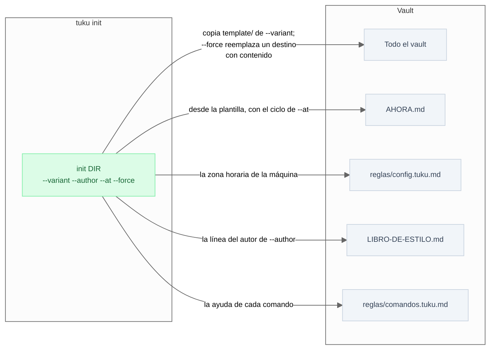
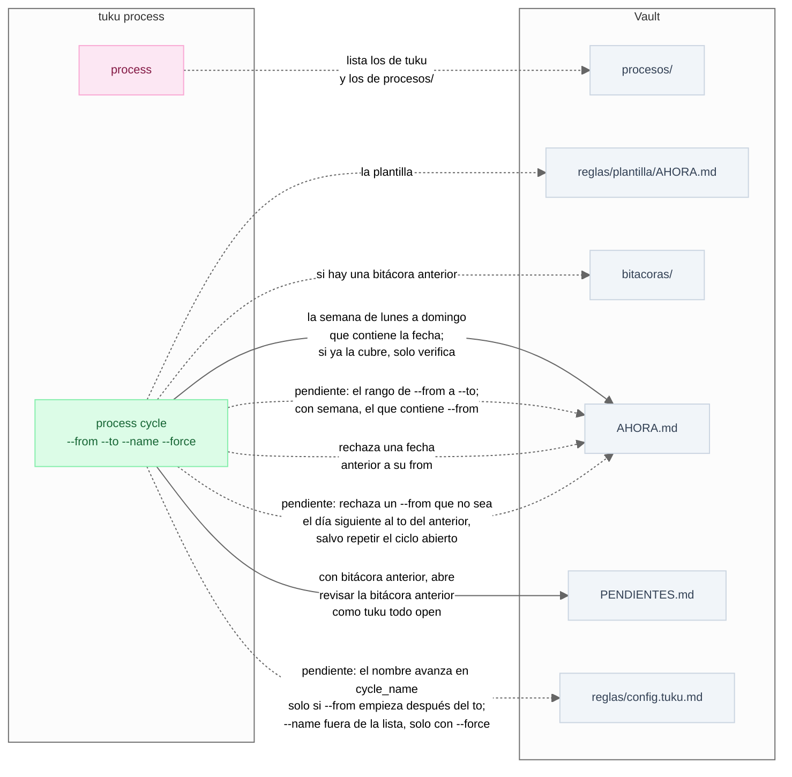
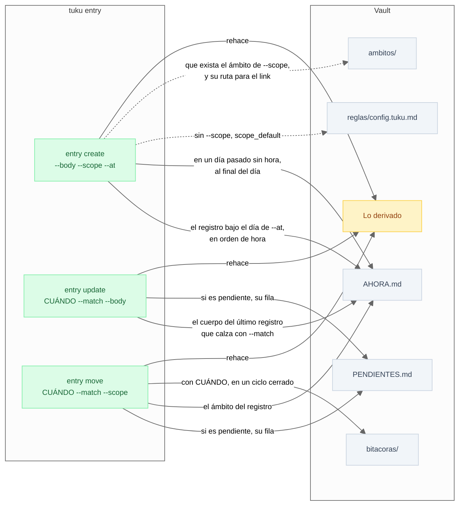
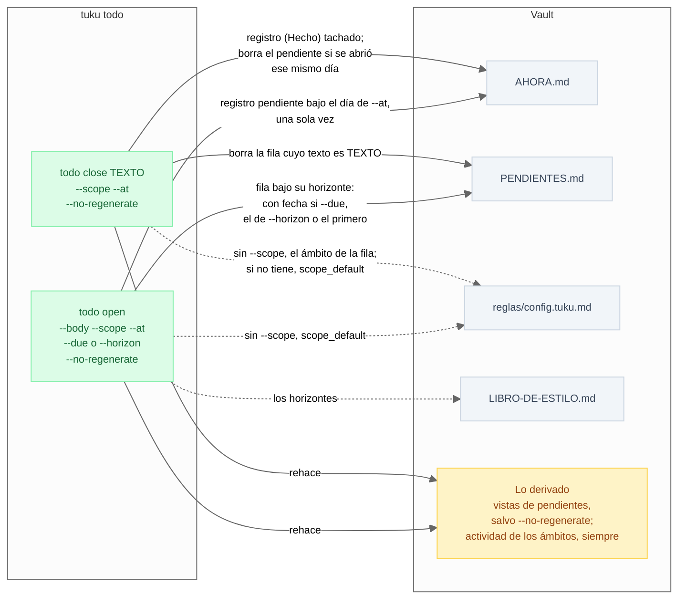
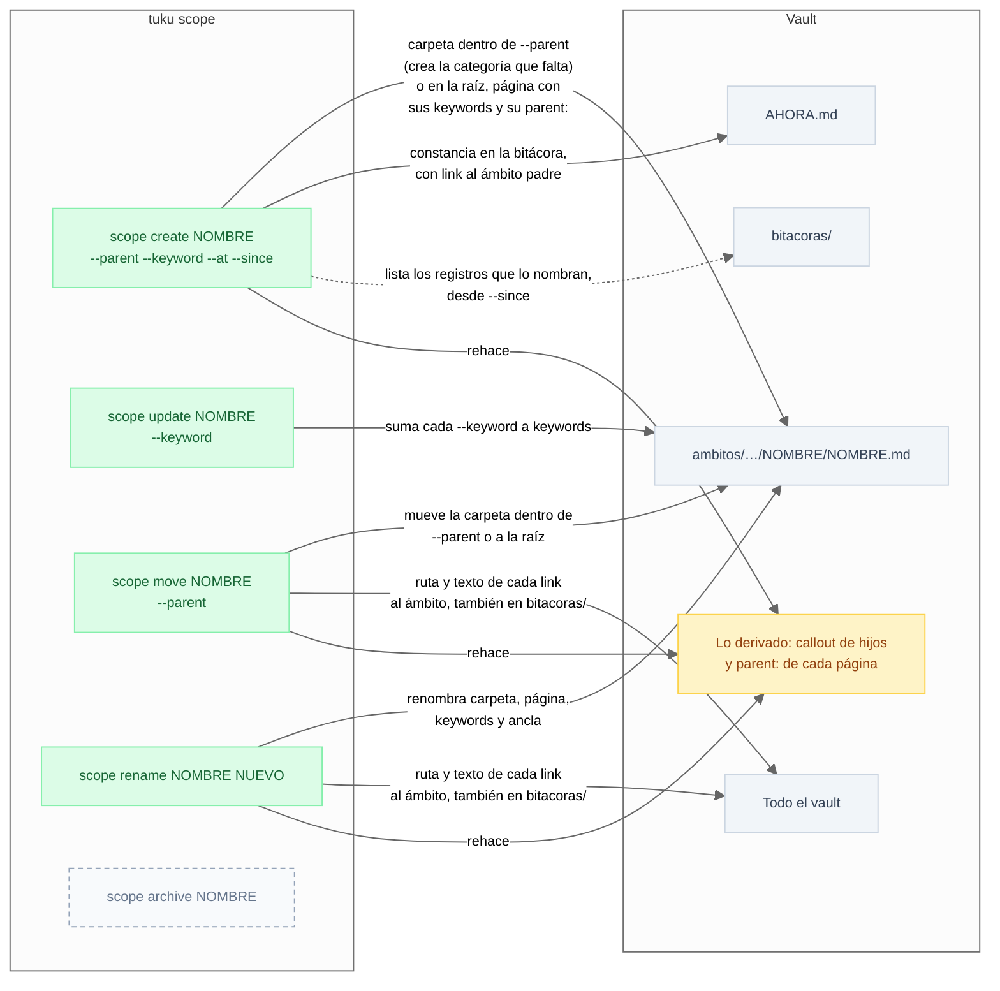
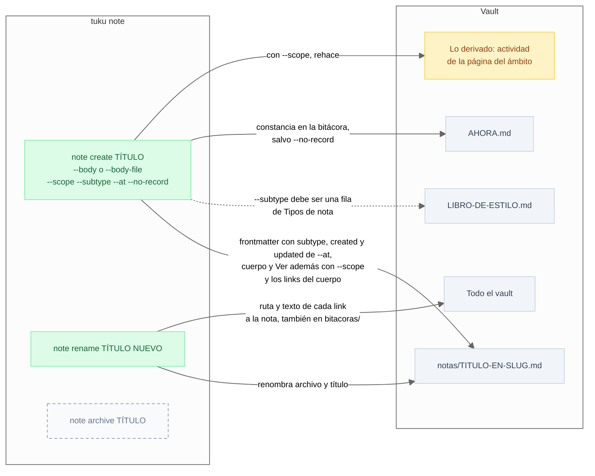
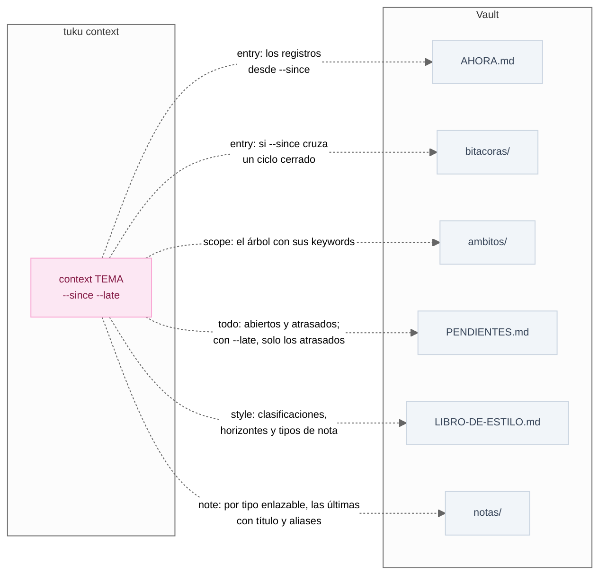
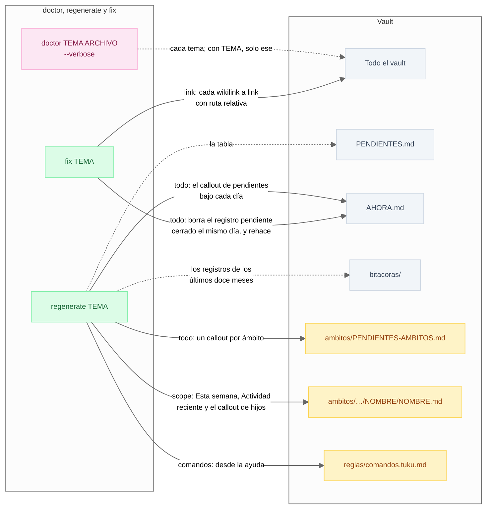

# spec · tuku

> La superficie del CLI: qué comandos hay, con qué firma, y qué archivos del vault lee y escribe cada uno. La gramática que comparten está en [cli.md](cli.md), y qué significa lo que escriben, en la spec de cada primitiva. [`test_superficie.py`](../tests/unitarios/test_superficie.py) compara cada firma con el árbol de argparse.

## Cómo se lee

**La firma.** Un bloque por sección, y es lo normativo. `[x]` es opcional, `(a | b)` es uno de los dos y `…` es repetible. `--vault` vale en todos los comandos salvo `init` y no se repite. `# pendiente` marca un comando especificado y sin implementar; `# pendiente: --opción` marca las piezas que le faltan a uno que existe.

**El diagrama.** La línea continua escribe y la punteada lee. Un rótulo que empieza con "pendiente:" es comportamiento especificado y sin implementar.

| Color | Qué es |
| --- | --- |
| Verde | Comando que escribe |
| Rosa | Comando que revisa o lee, sin escribir |
| Gris punteado | Comando sin implementar |
| Gris | Archivo del vault |
| Ámbar | Lo derivado, lo que rehace [`tuku regenerate`](#mantención) |

## Sembrar

```text
tuku init DIR [--variant] [--author] [--at] [--force]
```



## process

Un proceso es una rutina con nombre ([despacho.md](despacho.md)). Los de `tuku` son deterministas; los de `procesos/` los escribe el autor y los ejecuta el agente.

```text
tuku process
tuku process cycle [--from] [--to] [--name] [--force]   # pendiente: --from --to --name --force
```



## entry

```text
tuku entry create --body [--scope] [--at]
tuku entry update [CUÁNDO] --match TEXTO --body
tuku entry move [CUÁNDO] --match TEXTO --scope
```

`--match` ubica el último registro de `AHORA.md` que calza, y `CUÁNDO` busca en un ciclo cerrado ([bitacora.md](bitacora.md), "Corregir un registro ya escrito").



## todo

```text
tuku todo open --body [--scope] [--at] [--due | --horizon] [--no-regenerate]
tuku todo close TEXTO [--scope] [--at] [--no-regenerate]
```



## scope

```text
tuku scope create NOMBRE [--parent] [--keyword…] [--at] [--since]
tuku scope update NOMBRE [--keyword…]
tuku scope move NOMBRE [--parent]
tuku scope rename NOMBRE NUEVO
tuku scope archive NOMBRE                                           # pendiente
```

`--parent` acepta el nombre o la ruta (`negocio/clientes`). En `scope create`, `--since` vale 7 días por defecto ([ambitos.md](ambitos.md), "Lo escrito antes de abrir un ámbito").



## note

```text
tuku note create TÍTULO (--body | --body-file) [--scope] [--subtype] [--at] [--no-record]
tuku note rename TÍTULO NUEVO
tuku note archive TÍTULO                                            # pendiente
```



## context

Lo que el agente necesita para decidir, sin abrir archivos. Sin `TEMA`, todos.

```text
tuku context [TEMA] [--since] [--late]
```

`--since` (2 días por defecto) acota los registros de `entry`. `context note` trae las últimas notas de cada tipo enlazable, tantas como diga `context_note_limit` en `reglas/config.tuku.md` (25 por defecto). `--late` solo vale con `todo` y deja únicamente los pendientes atrasados.



## Mantención

Se distinguen por lo que escriben, y por eso se sabe cuál puede correr desatendido ([cli.md](cli.md)).

```text
tuku doctor [TEMA] [ARCHIVO] [--verbose]
tuku regenerate [TEMA]
tuku fix TEMA
```

| Comando | Escribe | Temas |
| --- | --- | --- |
| `doctor` | Nada | `config`, `version`, `types`, `files`, `frontmatter`, `dispatch`, `link`, `cycle`, `entry`, `todo`, `style`, `scope` y `note`, el único que acepta `ARCHIVO` |
| `regenerate` | Solo lo derivado | `todo`, `scope` y `comandos` |
| `fix` | Lo canónico, solo lo determinista, y devuelve las decisiones del autor | `link` y `todo` |



## Lo que se retira

Comandos y opciones que existen hoy y que la firma de arriba reemplaza. Una línea sale de aquí cuando sale del CLI ([`../TODO.md`](../TODO.md), "Superficie del CLI").

```text
tuku process cycle --at         → tuku process cycle --from
```
