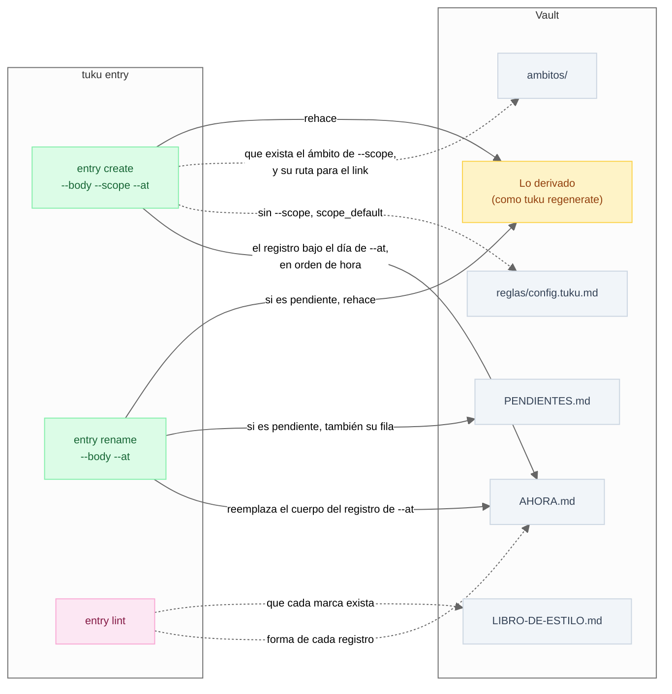
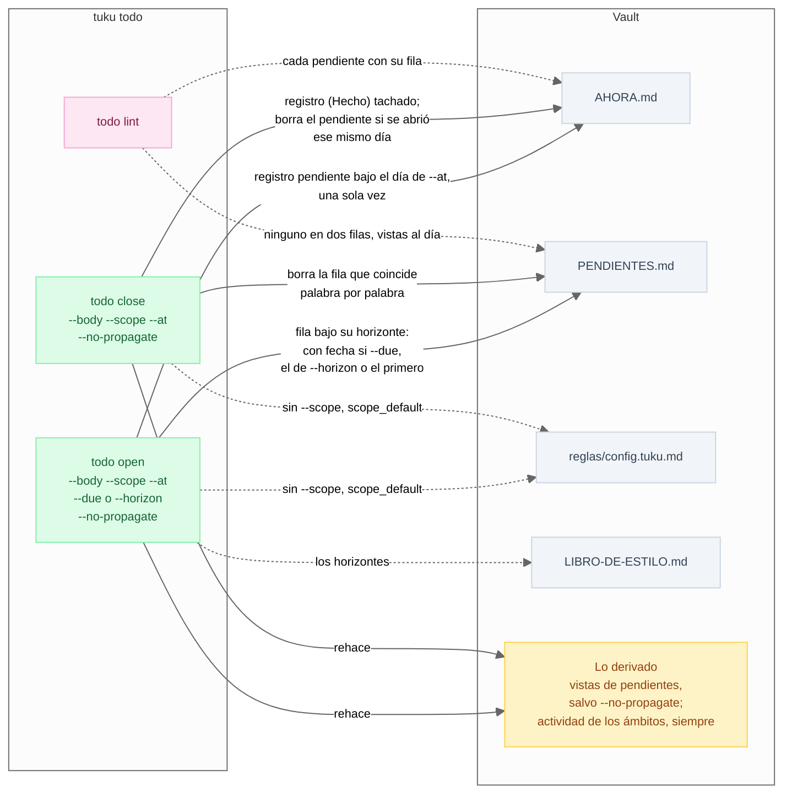
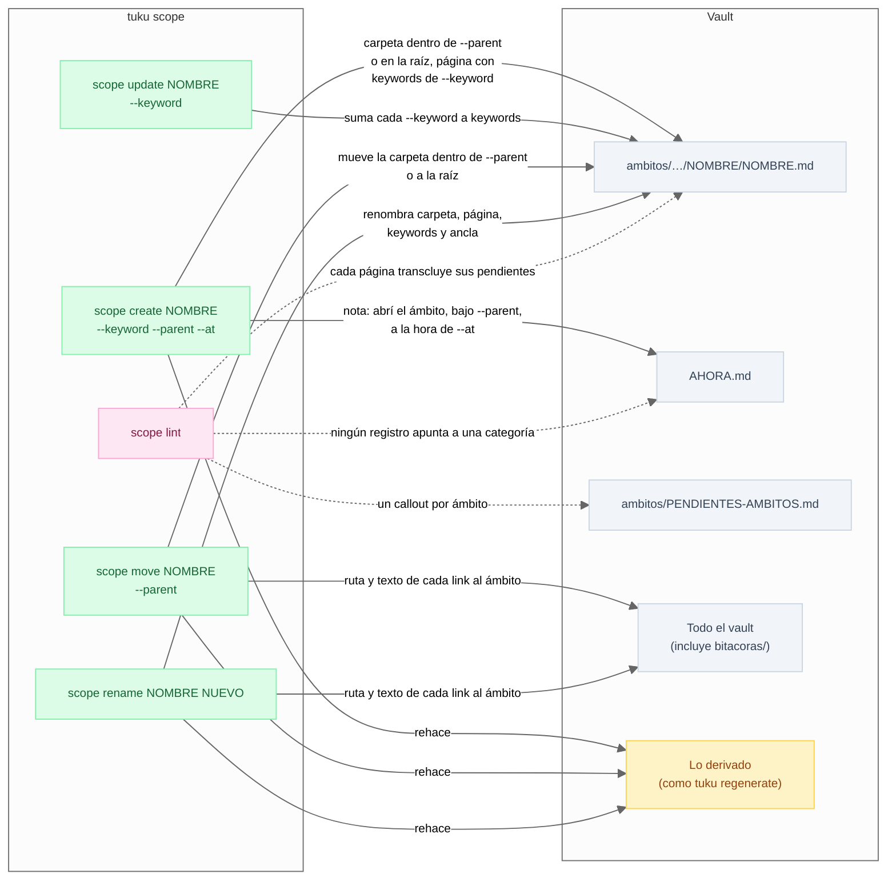
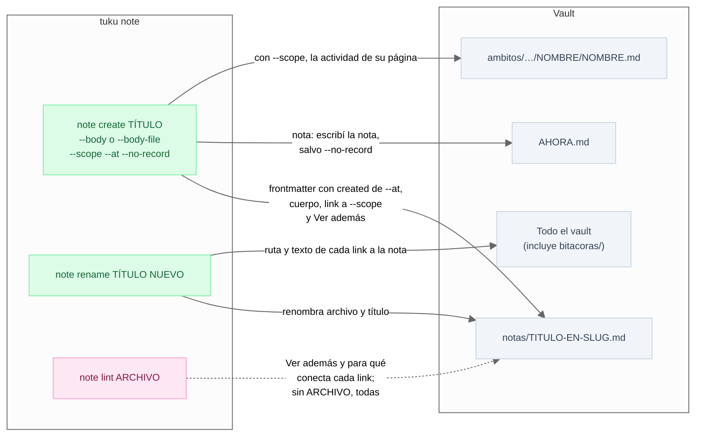
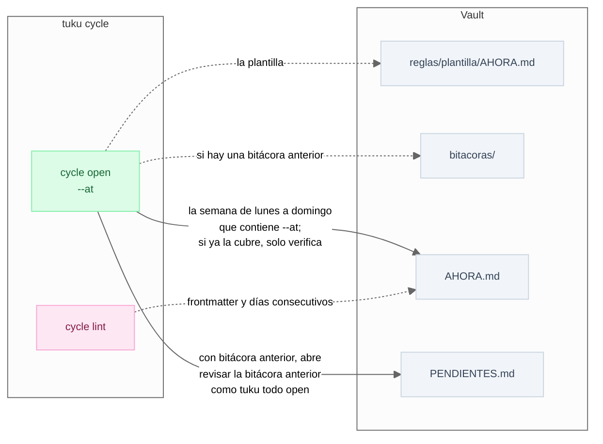
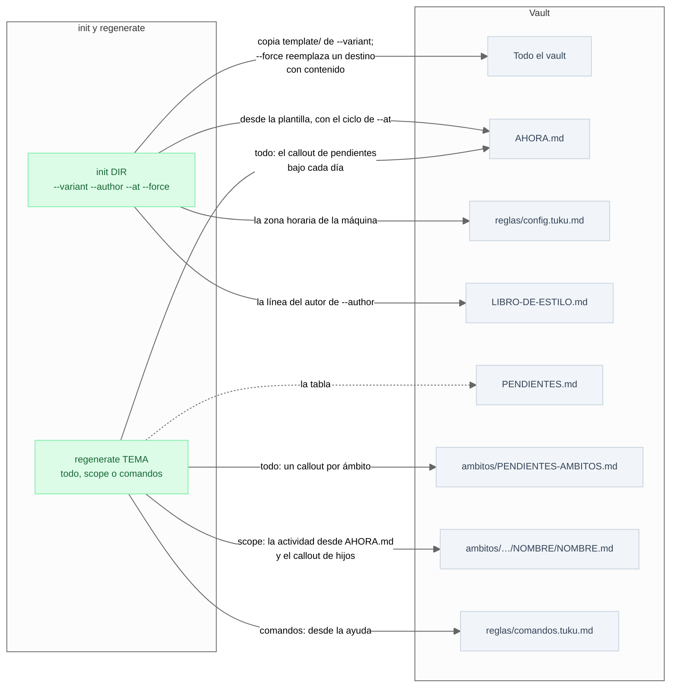
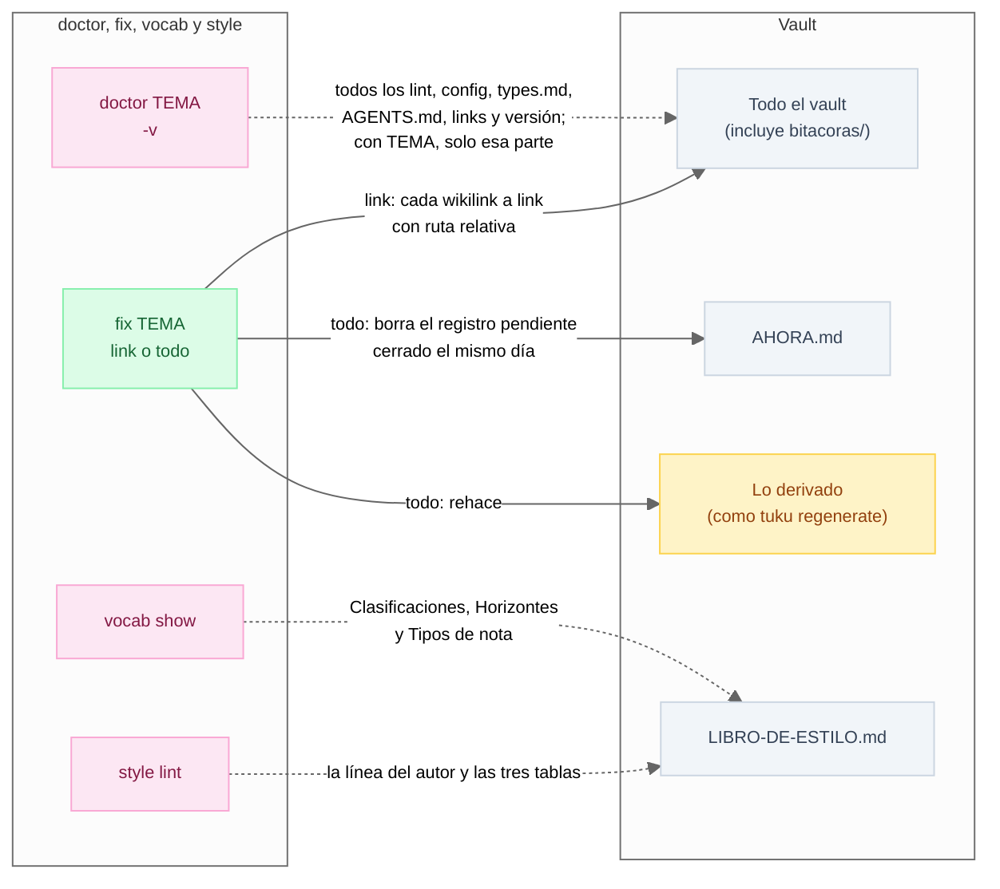

# spec · tuku

Qué archivos del vault lee (línea punteada) y escribe (línea continua) cada comando de `tuku` y cada opción, según su ayuda. Lo derivado es lo que rehace [`tuku regenerate`](#sembrar-y-regenerar), y `--vault` elige el vault en todos los comandos salvo `init`.

## entry

## todo

## scope

## note

## cycle

## Sembrar y regenerar

Sin TEMA, `regenerate` hace los tres.

## Revisar y reparar

