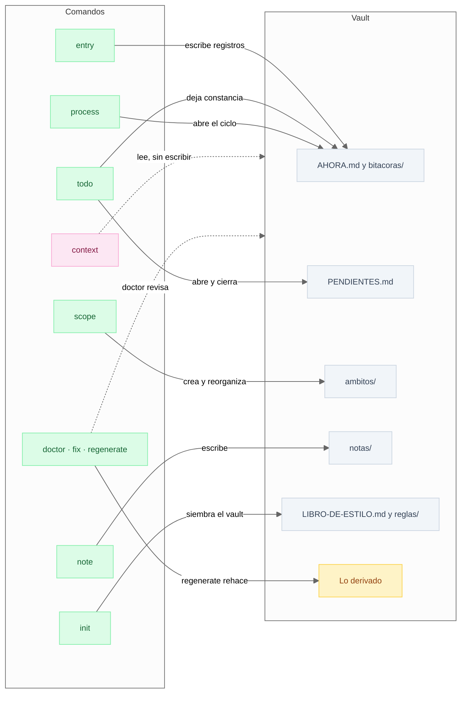

# spec · tuku

> La única spec del repositorio: la superficie del comando `tuku` y lo que garantiza. Es un mapa de alto nivel. El detalle de cada opción vive en `tuku … -h`, que dice qué archivos toca y cómo, y se copia en `reglas/comandos.tuku.md`.

## Quién manda

1. **El [libro de estilo](../template/vanilla/LIBRO-DE-ESTILO.md) manda sobre todo.** Dice qué se escribe y cómo, y cualquier cosa debe ser compatible con él: un comando `tuku`, una persona o un agente. Si un comando lo contradice, el defecto está en el comando.
2. **Este archivo manda sobre el código de los comandos.** Si discrepan, el defecto está en el código, salvo que este archivo contradiga al libro.
3. **`tuku … -h` es el detalle**, y los escenarios de [`tests/escenarios/`](../tests/escenarios/README.md) son el comportamiento verificado. [`test_superficie.py`](../tests/unitarios/test_superficie.py) compara el mapa de abajo con el árbol de argparse.

Esta spec cambia cuando el uso la contradice: el experimento manda sobre ella, no al revés ([`devel/epics.md`](../devel/epics.md)).

## Qué hace el comando y qué no

`tuku` es la capa determinista. Es dueño de la **forma**: dónde va cada cosa, en qué orden y qué invariantes no se rompen. El **juicio** es de quien invoca: qué se registra, con qué palabras y a qué ámbito pertenece. Un autor disciplinado hace lo mismo a mano con un editor: el comando le ahorra el esfuerzo y no habilita nada imposible sin él (principio 1).

- **Ningún comando infiere un campo que quien invoca no dio**, salvo los valores por defecto que declara el libro: hoy, ahora, y el primer horizonte.
- **Ante la duda informa y no escribe.** Un comando que no puede determinar algo no lo adivina ni escribe a medias.
- **Todo mutador es idempotente.** Repetirlo completa lo que falta y no duplica nada. Por eso el comando que repara un defecto es el comando original.
- **Verificar no repara.** `doctor` nombra el defecto y la corrección y no modifica archivos; `fix` aplica lo determinista y devuelve como decisiones lo que requiere juicio.
- **Fuera de un vault no opera.** Sin ninguno de los archivos requeridos, rechaza con código 1 y no lee ni escribe. `tuku init` rechaza además el home del usuario y todo directorio que lo contenga, aun con `--force`.
- **Escribe con el vault abierto en otro editor.** Cada archivo se reemplaza de una vez y solo si no cambió desde que se leyó; si cambió, reintenta y, si sigue chocando, dice qué quedó escrito y que repetir el comando completa el resto.

## Gramática

`tuku SUSTANTIVO VERBO [POSICIONAL] [--opción]`, y cada pieza significa lo mismo en todos los comandos.

- **Sustantivos:** `entry`, `todo`, `scope` y `note` son las cosas del vault. `process` y `context` llevan un `TEMA`. `init`, `doctor`, `regenerate` y `fix` actúan sobre el vault entero.
- **Verbos:** `create` nace, `open` y `close` abren y cierran lo que tiene ciclo de vida, `update` cambia atributos, `move` cambia de dónde cuelga, `rename` cambia la identidad y con ella cada link, `archive` saca de circulación sin borrar.
- **Opciones:** un parámetro tiene un solo significado en todo el CLI, y un comando nuevo usa el que ya existe antes de inventar otro. `--at` es cuándo ocurrió, `--scope` y `--parent` dicen dónde va, `--body` es el contenido, `--match` ubica un registro, `--since` dice desde cuándo leer, `--no-X` omite un efecto colateral. Solo `-h` y `-v` tienen forma corta.
- **`TEMA`** es el nombre de la cosa y significa lo mismo en `doctor`, `fix`, `regenerate` y `context`. Uno desconocido es un error de uso.

## Salida y códigos

Un solo mensaje en prosa, para persona y para agente. Sin `--json`: los códigos de salida son el canal para máquinas.

| Código | Significa | Qué hacer |
| --- | --- | --- |
| 0 | Éxito | Seguir |
| 1 | Rechazo: el comando entendió y se negó por el estado del vault | Corregir el estado, o pasar la opción que la salida indica |
| 2 | Error de uso: la invocación está mal formada | Corregir la invocación |
| 3 | Entorno: la instalación de TUKU no está donde debería | No reintentar; se arregla la instalación |

El 2 está reservado a argparse y ningún comando lo devuelve por otra causa. Un código nuevo entra en esta tabla antes que en el código, y vive en `tuku/cli/` como constante con nombre.

**Toda salida de error nombra el defecto y la corrección.** Un aviso no es un error: el comando procede, sale con 0 y escribe en `stderr` una línea `tuku <comando>: warning: …`.

## Cómo se lee el mapa

Un bloque por sustantivo, con la firma en lo alto: los comandos y sus argumentos principales, sin cada opción. `# pendiente` marca un comando especificado y sin implementar. El diagrama dice qué archivos lee y escribe cada sustantivo: la línea continua escribe y la punteada lee.



## Sembrar

```text
tuku init DIR [--variant] [--author] [--at] [--force]
```

Copia el template al directorio sin tocar la red y deja el primer ciclo abierto. Rechaza un destino con contenido salvo `--force`.

## entry

```text
tuku entry create --body [--scope] [--at]
tuku entry update [CUÁNDO] --match TEXTO --body
tuku entry move [CUÁNDO] --match TEXTO --scope
```

Escribe y corrige registros de la bitácora, en orden de hora. `--match` ubica el último registro que calza, y `CUÁNDO` busca en un ciclo cerrado. Rechaza un día fuera del ciclo abierto y dice cómo cambiar de ciclo. Qué es un registro y cómo se escribe está en el capítulo Registro del libro.

## todo

```text
tuku todo open --body [--scope] [--at] [--due | --horizon]
tuku todo close TEXTO [--scope] [--at]
tuku todo update TEXTO [--horizon] [--due]                          # pendiente
```

Abre y cierra pendientes: el registro en la bitácora y la fila en `PENDIENTES.md`, sincronizados. `todo update` posterga un pendiente y corrige su `Vence`. Capítulo Pendiente.

## scope

```text
tuku scope create NOMBRE [--parent] [--keyword…] [--since]
tuku scope update NOMBRE [--keyword…]
tuku scope move NOMBRE [--parent]
tuku scope rename NOMBRE NUEVO
tuku scope archive NOMBRE                                           # pendiente
```

Crea y reorganiza el árbol de `ambitos/`. `move` y `rename` recalculan los links de todo el vault, también los de las bitácoras cerradas. Capítulo Ámbito.

## note

```text
tuku note create TÍTULO (--body | --body-file) [--scope] [--subtype] [--alias…]
tuku note rename TÍTULO NUEVO
tuku note archive TÍTULO                                            # pendiente
```

Escribe la nota en `notas/` y deja su constancia en la bitácora. Capítulo Nota.

## process

```text
tuku process
tuku process cycle [--from] [--to] [--name]
```

Una rutina con nombre. Sin nombre lista las de `tuku` y las que el autor escribe en `procesos/`. `process cycle` abre el siguiente ciclo, o repite el abierto y solo verifica. Capítulo Ciclo.

## context

```text
tuku context [TEMA] [--since] [--late] [--chapter]
```

Lo que el agente necesita para decidir, sin abrir archivos. Solo lee. `context style` devuelve el libro con las transclusiones expandidas, entero o un capítulo.

## Mantención

```text
tuku doctor [TEMA] [ARCHIVO]
tuku fix TEMA
tuku regenerate [TEMA]
```

Se distinguen por lo que escriben. `doctor` no escribe nada y verifica el vault entero o un tema. `fix` repara solo lo determinista y devuelve lo demás como decisiones. `regenerate` rehace solo lo derivado: las vistas de pendientes, la actividad de los ámbitos, `reglas/comandos.tuku.md` y el libro de estilo.

## La ayuda es la spec del detalle

Todo sustantivo y verbo lleva en `tuku … -h` un párrafo que dice qué archivos del vault lee o escribe y cómo, con precisión suficiente para hacerlo con un editor. Es el equivalente manual que pide el principio 1, y `tuku init` lo copia en `reglas/comandos.tuku.md` para que el vault lo diga aunque `tuku` no esté instalado. Un test exige que ningún comando invocable quede sin esa descripción.
